# Operations Reporting & Exception Management Automation

A Microsoft 365 automation portfolio project that combines **Excel VBA, Power Automate Desktop, Power Automate Cloud, Office Scripts, OneDrive for Business, Outlook, and Microsoft Teams** to process operational data, calculate KPIs, detect exceptions, and route review notifications.

> **Note:** This project uses fictional practice data and is not affiliated with or deployed by any specific employer. The screenshots and sample records are for demonstration only.

## What this project demonstrates

- Excel/VBA automation for operational reporting
- Configurable KPI and exception rules
- Data-quality validation and duplicate/missing-value detection
- Power Automate Desktop orchestration of Excel and VBA
- Office Scripts for cloud-compatible Excel automation
- Structured data returned from Office Scripts to Power Automate Cloud
- True/False conditional routing
- Outlook review-required and no-exception emails
- Microsoft Teams notification action for exception cases
- Manual test flow and recurrence-based scheduled flow
- OneDrive for Business integration

## Architecture

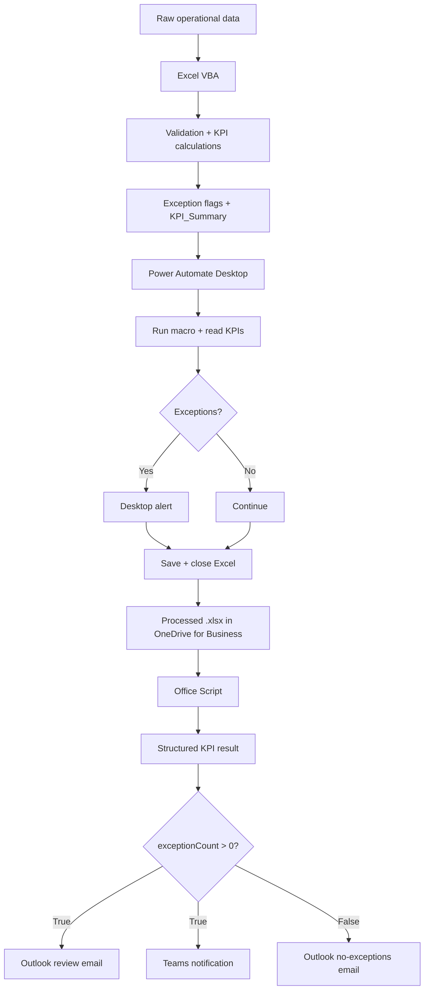

See [docs/architecture.md](docs/architecture.md) for more detail.

## Operational rules

The VBA processor reads thresholds from the `Config` sheet rather than hard-coding the rules.

| Rule | Example threshold | Flag |
|---|---:|---|
| Error rate | > 2% | `HIGH_ERROR_RATE` |
| Late-order rate | > 5% | `HIGH_LATE_ORDER_RATE` |
| Orders/hour | < 15 | `LOW_PRODUCTIVITY` |
| Return rate | > 3% | `HIGH_RETURN_RATE` |

It also detects data-quality issues such as missing employee IDs, missing warehouse values, and duplicate order IDs.

## Demonstrated sample run

The included fictional dataset produced the following test results:

| KPI | Result |
|---|---:|
| Records processed | 600 |
| Unique order IDs | 590 |
| Total orders processed | 70,009 |
| Total units picked | 331,723 |
| Overall error rate | 1.12% |
| Late order rate | 2.50% |
| Return rate | 1.46% |
| Overall orders/hour | 15.17 |
| Exception records | 381 |

Full test notes are in [docs/test-results.md](docs/test-results.md).

## Evidence

### Processed operational data

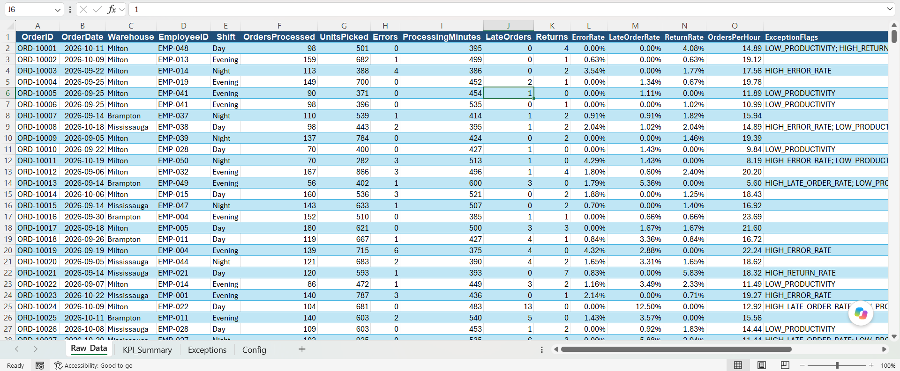

### Exception report

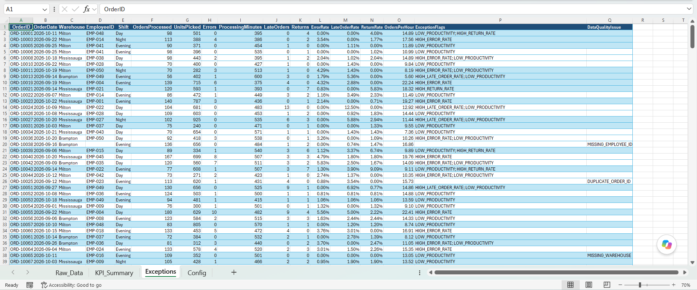

### KPI summary and successful Office Script execution

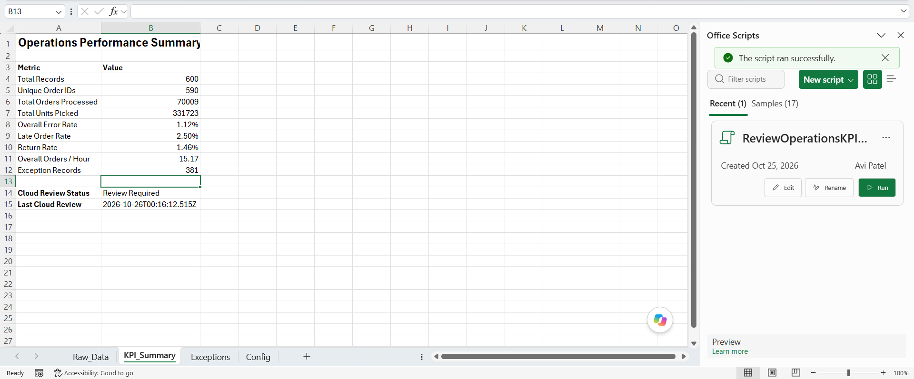

### Power Automate Desktop flow

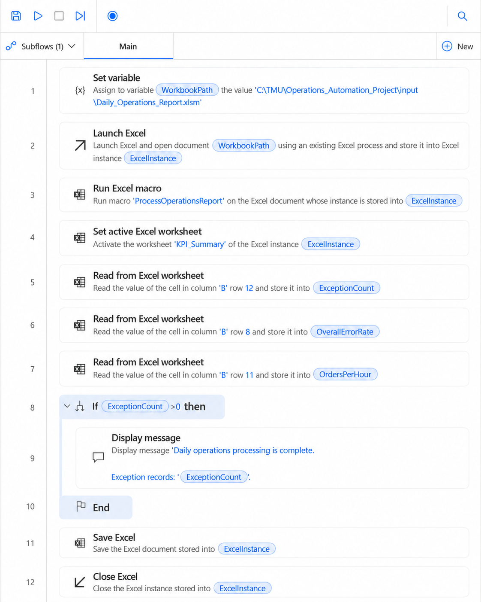

### Power Automate Desktop runtime alert

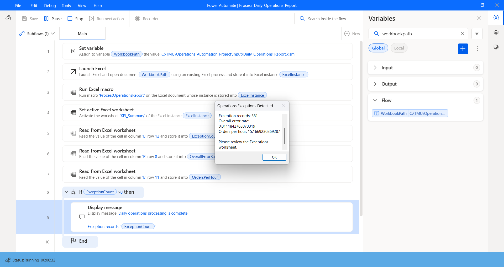

### Office Script

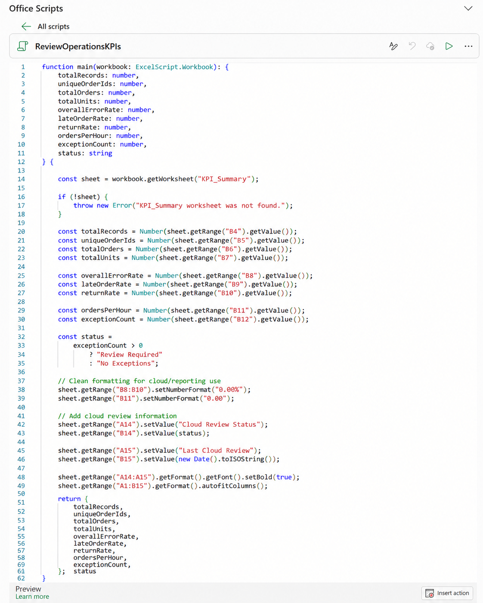

### Manual Power Automate Cloud flow

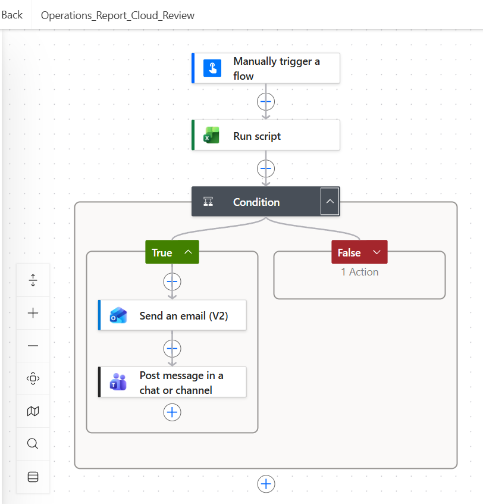

### Scheduled Power Automate Cloud flow

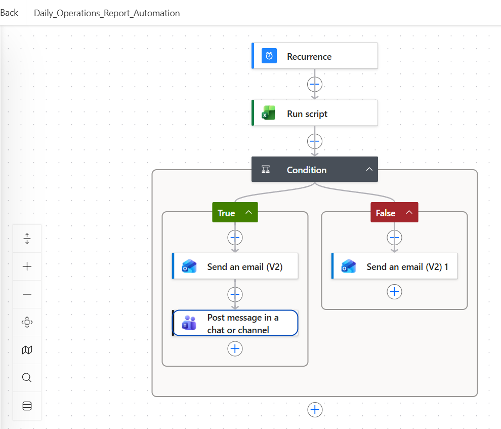

### True branch — review required

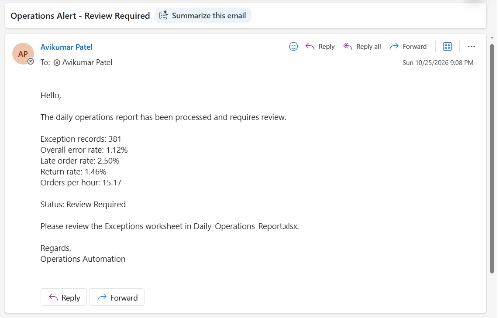

### False branch — no exceptions

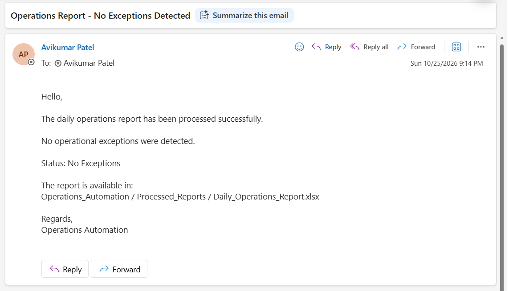

## Repository structure

```text
operations-reporting-exception-automation/
├── README.md
├── SECURITY.md
├── .gitignore
├── project-manifest.json
├── src/
│   ├── vba/
│   │   └── ProcessOperationsReport.bas
│   └── office-scripts/
│       └── ReviewOperationsKPIs.ts
├── flows/
│   ├── power-automate-desktop.md
│   └── power-automate-cloud.md
├── docs/
│   ├── architecture.md
│   ├── setup-guide.md
│   ├── test-results.md
│   ├── portfolio-wording.md
│   └── images/
└── samples/
    └── operations_automation_practice_data.xlsx
```

## How to reproduce

1. Review [docs/setup-guide.md](docs/setup-guide.md).
2. Use the fictional workbook in `samples/` as the practice-data source.
3. Create a macro-enabled Excel workbook with `Raw_Data`, `KPI_Summary`, `Exceptions`, and `Config` sheets.
4. Import `src/vba/ProcessOperationsReport.bas` into a standard VBA module.
5. Build the desktop flow from [flows/power-automate-desktop.md](flows/power-automate-desktop.md).
6. Save a macro-free `.xlsx` copy to OneDrive for Business.
7. Create `ReviewOperationsKPIs` from `src/office-scripts/ReviewOperationsKPIs.ts`.
8. Build the cloud flow from [flows/power-automate-cloud.md](flows/power-automate-cloud.md).

## Why the `.xlsm` file is not committed

The public repository commits the VBA source rather than the macro-enabled workbook. This keeps the project portable and reduces the risk of publishing machine-specific or embedded content. The cloud stage uses a separate macro-free `.xlsx` copy.

## Skills demonstrated

**Excel VBA · Power Automate Desktop · Power Automate Cloud · Office Scripts · TypeScript · OneDrive for Business · Outlook Automation · Microsoft Teams · Microsoft 365 · KPI Reporting · Data Validation · Conditional Workflows · Exception Management**
