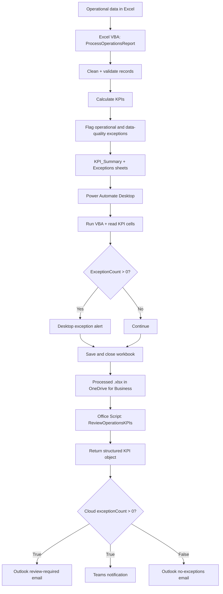

# Architecture

## Separation of responsibilities

- **VBA:** local data preparation, validation, KPI calculations, exception detection, and worksheet output.
- **Power Automate Desktop:** desktop orchestration around Excel and VBA.
- **Office Scripts:** cloud-friendly KPI extraction, formatting, timestamping, and structured return values.
- **Power Automate Cloud:** scheduling, branching, Outlook notifications, and Teams routing.
- **OneDrive for Business:** cloud storage for the processed workbook used by Excel Online (Business).
